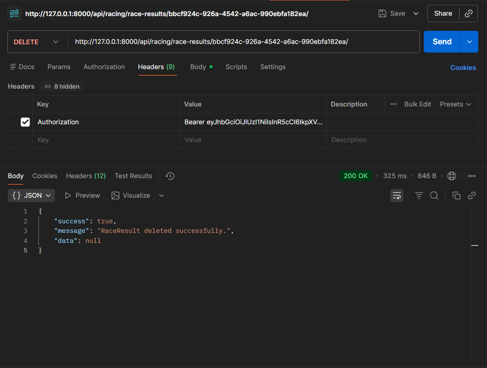

# Formula 1 — Django REST API

A **Django REST Framework** backend for a Formula 1 platform, providing APIs for racing data, championship standings, articles, user accounts, and favorites. It also includes **F1 AI Analyst**, a conversational assistant that combines LLM tool calling with Retrieval-Augmented Generation (RAG).

The user-facing application is available in the [React frontend repository](https://github.com/ali-mogharrab/f1-frontend).

## Features

- **Racing data:** Seasons, drivers, teams, circuits, races, qualifying, sprint results, and race results.
- **Championship standings:** Driver and constructor rankings with season-based statistics.
- **Content management:** Articles, categories, tags, publishing states, and links to drivers, teams, and races.
- **Authentication:** JWT-based login, registration, profiles, password management, and protected endpoints.
- **Favorites:** User-specific favorite drivers, teams, and races.
- **API development:** Search, filtering, ordering, pagination, permissions, and OpenAPI documentation.
- **AI analysis:** Questions about race statistics and published articles, with saved conversations and source references.

## F1 AI Analyst

The AI Analyst integrates the **OpenAI Responses API** to coordinate tool calls and generate answers using data from the application.

### Structured F1 data

Seven registered, read-only tools let the assistant retrieve and compare driver results, team performance, race results, and championship standings, or search articles. Tool arguments are validated before Django ORM queries run, so the model has no unrestricted database access.

### Retrieval-Augmented Generation

Published articles are cleaned, split into text chunks, and converted into embeddings. Each chunk is stored with its original text and metadata. When an article-related question is asked, the system embeds the search query, finds relevant chunks through vector similarity search, and passes their text back to the generation layer.

**PostgreSQL with pgvector** is used for vector retrieval, with a SQLite cosine-similarity fallback for local development. Article indexing uses content fingerprints to skip unchanged articles and replace outdated chunks when indexing is run again.

### Conversations and sources

The orchestration layer can combine structured racing statistics with retrieved article passages in a single answer. It also manages conversation context, tool-call limits, and source references. Citations are validated against the records returned by the tools, and authenticated users can revisit previous conversations.

An **offline demo** is included for running the same API and retrieval workflow using synthetic F1 data, deterministic embeddings, and scripted responses without an OpenAI API key.

## Tech Stack

**Python · Django · Django REST Framework · PostgreSQL · pgvector · SQLite · OpenAI Python SDK · Pydantic · Simple JWT · drf-spectacular**

## API Overview

| Area | Main endpoints |
| --- | --- |
| Racing | `/api/racing/seasons/`, `/drivers/`, `/teams/`, `/circuits/`, `/races/`, `/race-results/`, `/qualifying-results/`, `/sprint-results/` |
| Standings | `/api/standings/drivers/`, `/api/standings/constructors/` |
| Articles | `/api/content/articles/`, `/categories/`, `/tags/` |
| Users | `/api/users/register/`, `/token/`, `/profile/`, `/dashboard/` |
| Favorites | `/api/users/favorites/drivers/`, `/teams/`, `/races/` |
| AI Analyst | `POST /api/ai/chat/`, `GET /api/ai/conversations/`, `GET /api/ai/conversations/{id}/` |

The AI endpoints require JWT authentication. Interactive API documentation is available at `/api/docs/` (Swagger UI), `/api/redoc/` (ReDoc), and `/api/schema/` (OpenAPI schema).

## API Screenshots

### Get Drivers


### Create Circuit


### Update Race Result


### Delete Race Result



## Local Setup

Requires **Python 3.12+**. The following commands use Linux, macOS, or WSL:

```bash
python3 -m venv .venv
source .venv/bin/activate
pip install -r requirements/development.txt
cp .env.example .env
export DEBUG=True
export DJANGO_SETTINGS_MODULE=config.settings.development
python manage.py migrate
python manage.py runserver 127.0.0.1:8000
```

Configure `.env` for your environment. To populate the local racing database with sample records, you can run `python manage.py seed_demo_data`.

### Offline AI Demo

The demo uses its own SQLite database and requires no external AI service. With the backend dependencies installed:

```bash
export DEBUG=True
export DJANGO_SETTINGS_MODULE=config.settings.demo
python manage.py setup_ai_demo
python manage.py createsuperuser --username demo --email demo@example.com
python manage.py runserver 127.0.0.1:8000
```

Create the account once and choose your own password. Start the [frontend](https://github.com/ali-mogharrab/f1-frontend), sign in, and open `/ai-analyst` to try questions about Ferrari, McLaren, and the sample articles.

For the OpenAI provider, configure the backend `OPENAI_API_KEY` and model settings, use the normal development or production configuration, and index published articles with:

```bash
python manage.py index_articles
```

Indexing is a separate operation; embeddings for unchanged articles are reused across chat requests.

## Testing and CI

```bash
DEBUG=False python manage.py test --settings=config.settings.test
DEBUG=False python manage.py check --settings=config.settings.test
DEBUG=False python manage.py makemigrations --check --dry-run --settings=config.settings.test
```

GitHub Actions runs the Django checks and automated tests, including a PostgreSQL/pgvector job for the AI app. AI tests use mocked or offline providers, so they can run without paid API calls.
