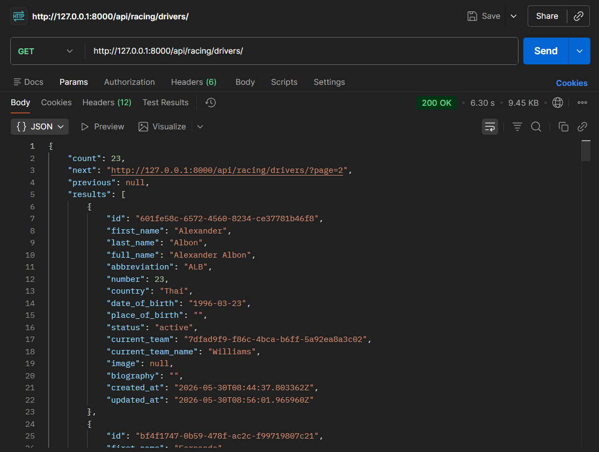
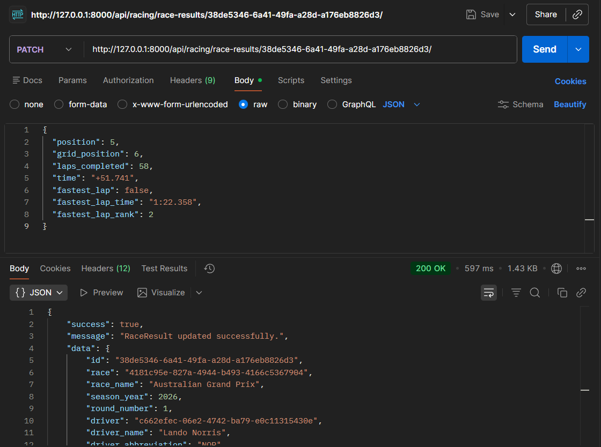

# Formula 1 API Backend

A Django REST Framework backend for a Formula 1 web application. The project provides a structured API for racing data, championship standings, user accounts, favorites, and editorial content that can be consumed by a React frontend.

The backend is organized as a modular Django project with separate apps for racing data, standings, users, shared core utilities, and content management.

## Features

### F1 AI Analyst

Authenticated assistant using pretrained models, Responses API function calling,
read-only ORM tools, and semantic retrieval over published articles. Includes
owned conversations, PostgreSQL/pgvector storage with working SQLite retrieval,
incremental indexing, offline mocked tests, and labeled evaluation cases.
See [AI architecture, setup, API, and evaluation](docs/ai-analyst.md).

An optional offline portfolio demo exercises the same tool, retrieval, citation,
and conversation pipelines with scripted generation and lexical demo vectors.
It requires no API key or model download and uses a separate synthetic SQLite
database. It does not provide LLM reasoning or production semantic search.

With backend dependencies installed:

```bash
DEBUG=True python manage.py setup_ai_demo --settings=config.settings.demo
DEBUG=True python manage.py createsuperuser --username demo --email demo@example.com --settings=config.settings.demo
DEBUG=True python manage.py runserver 127.0.0.1:8000 --settings=config.settings.demo
```

Try `Compare Ferrari and McLaren's performance.`,
`What do the articles say about Ferrari?`, or
`Analyze McLaren's race results and related articles.` through the authenticated
chat API. See the [offline demo guide](docs/ai-analyst.md#offline-portfolio-demonstration)
for JWT requests, supported questions, safe repeatable setup, and switching back
to real OpenAI providers. Demo providers are disabled by default and rejected in
production settings.

### Racing Data

- Seasons, teams, drivers, circuits, and races
- Race calendar support with current season, upcoming race, and latest race endpoints
- Race results with positions, grid positions, laps, fastest laps, points, and race status
- Qualifying results with Q1, Q2, and Q3 timing fields
- Sprint results with sprint positions, grid positions, points, and status
- Search, filtering, ordering, and pagination for list endpoints

### Championship Standings

- Driver championship standings by season
- Constructor championship standings by season
- Standing statistics such as points, wins, podiums, poles, fastest laps, race entries, finishes, DNFs, double podiums, and double points finishes

### Users and Authentication

- Custom UUID-based user model
- JWT authentication with access, refresh, and token verification endpoints
- User registration
- Current authenticated user endpoint
- User profile endpoint with avatar, country, bio, and favorite driver/team names
- Password change and password reset flow
- User dashboard summary

### Favorites

Authenticated users can save and manage:

- Favorite drivers
- Favorite teams
- Favorite races

The API prevents duplicate favorites per user.

### Content and Articles

- Categories and tags
- Article/news publishing system
- Draft, published, and archived article states
- Featured articles
- Article detail by UUID or slug
- Article relationships to races, drivers, and teams
- Automatic slug generation
- View count tracking
- Public users see published content, while staff users can manage broader content states

### API Quality

- OpenAPI schema generation with drf-spectacular
- Swagger UI and ReDoc documentation
- Shared success and error response helpers
- Admin-only write access for public racing, standings, and content resources
- Public read access for public resources
- Centralized pagination, filtering, searching, ordering, and exception handling
- CORS support for React development clients
- Demo data seeding command for local development

## Tech Stack

- Python
- Django
- Django REST Framework
- Simple JWT
- django-filter
- django-cors-headers
- drf-spectacular
- Pillow
- python-decouple
- SQLite for local development

## Project Structure

```txt
.
├── apps/
│   ├── ai/            # LLM tools, article RAG, conversations, and evaluations
│   ├── content/       # Categories, tags, articles, and featured content
│   ├── core/          # Shared responses, permissions, pagination, utilities
│   ├── racing/        # Seasons, teams, drivers, circuits, races, and results
│   ├── standings/     # Driver and constructor standings
│   └── users/         # Custom users, profiles, authentication, favorites
├── config/
│   ├── settings/      # Base, development, and production settings modules
│   ├── urls.py
│   ├── asgi.py
│   └── wsgi.py
├── requirements/
│   ├── base.txt
│   ├── development.txt
│   └── production.txt
├── manage.py
└── README.md
```

## Main API Areas

### Racing

Base path: `/api/racing/`

- `/seasons/`
- `/seasons/current/`
- `/teams/`
- `/drivers/`
- `/circuits/`
- `/races/`
- `/races/upcoming/`
- `/races/latest/`
- `/race-results/`
- `/qualifying-results/`
- `/sprint-results/`

### Standings

Base path: `/api/standings/`

- `/drivers/`
- `/constructors/`

### Users

Base path: `/api/users/`

- `/register/`
- `/token/`
- `/token/refresh/`
- `/token/verify/`
- `/me/`
- `/profile/`
- `/dashboard/`
- `/favorites/drivers/`
- `/favorites/teams/`
- `/favorites/races/`
- `/password/change/`
- `/password/reset/`
- `/password/reset/confirm/`

### Content

Base path: `/api/content/`

- `/categories/`
- `/tags/`
- `/articles/`
- `/articles/featured/`
- `/articles/<uuid>/`
- `/articles/slug/<slug>/`

## API Documentation

When the development server is running, interactive API documentation is available at:

```txt
/api/docs/    # Swagger UI
/api/redoc/   # ReDoc
/api/schema/  # OpenAPI schema
```

## API Request Screenshots

The screenshots below show example API requests tested with Postman.

### Get Drivers



### Create Circuit


### Update Race Result



### Delete Race Result


## Local Development

Use Python 3.12+ and an isolated virtual environment. Set
`DJANGO_SETTINGS_MODULE=config.settings.development` explicitly for local work;
the example environment file also contains deployment settings.

Install dependencies:

```bash
python3 -m venv .venv
source .venv/bin/activate
pip install -r requirements/development.txt
```

Create an environment file from the example:

```bash
cp -n .env.example .env
export DJANGO_SETTINGS_MODULE=config.settings.development
```

Run migrations:

```bash
python manage.py migrate
```

Optionally seed demo data:

```bash
python manage.py seed_demo_data
```

Start the development server:

```bash
python manage.py runserver
```

## Notes

### Verification and account security

```bash
DEBUG=False OPENAI_API_KEY='' python manage.py test --settings=config.settings.test
DEBUG=False python manage.py check --settings=config.settings.test
DEBUG=False python manage.py makemigrations --check --dry-run --settings=config.settings.test
DEBUG=False python manage.py spectacular --validate --fail-on-warn --file /tmp/f1-schema.yml --settings=config.settings.test
```

Tests use a separate in-memory SQLite database and mocked OpenAI transport or
explicit offline providers. The PostgreSQL CI job must pass separately; a SQLite
run does not verify pgvector behavior.

Password changes and resets invalidate previously issued access and refresh
tokens. This also means tokens issued before enabling password-bound JWT claims
require a fresh login. Deleted/inactive users cannot refresh a session. Public
login, registration, password-reset, and refresh endpoints have separate per-IP
limits (`AUTH_LOGIN_RATE`, `AUTH_REGISTRATION_RATE`, `AUTH_PASSWORD_RESET_RATE`,
`AUTH_REFRESH_RATE`). They share the configurable `ai` cache. Configure a shared
cache and trusted proxy handling before using multiple production workers;
application throttles do not replace gateway abuse limits.

Historical completed races before today may use the race-time team; past-season
standings may use the season team. Current/future race records and current-season
standing snapshots retain the existing current-team validation. The database
does not contain a complete driver contract/team-membership timeline.

See the [independent review and verification report](docs/review-2026-11-11.md)
for the reviewed scope, fixes, commands, and remaining deployment limitations.

This repository contains the backend API for the Formula 1 web application. It is designed to pair with a React frontend and focuses on providing clean, structured data for race information, standings, personalized user features, and F1-related editorial content.
